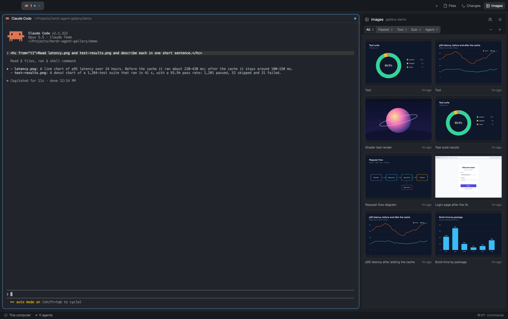
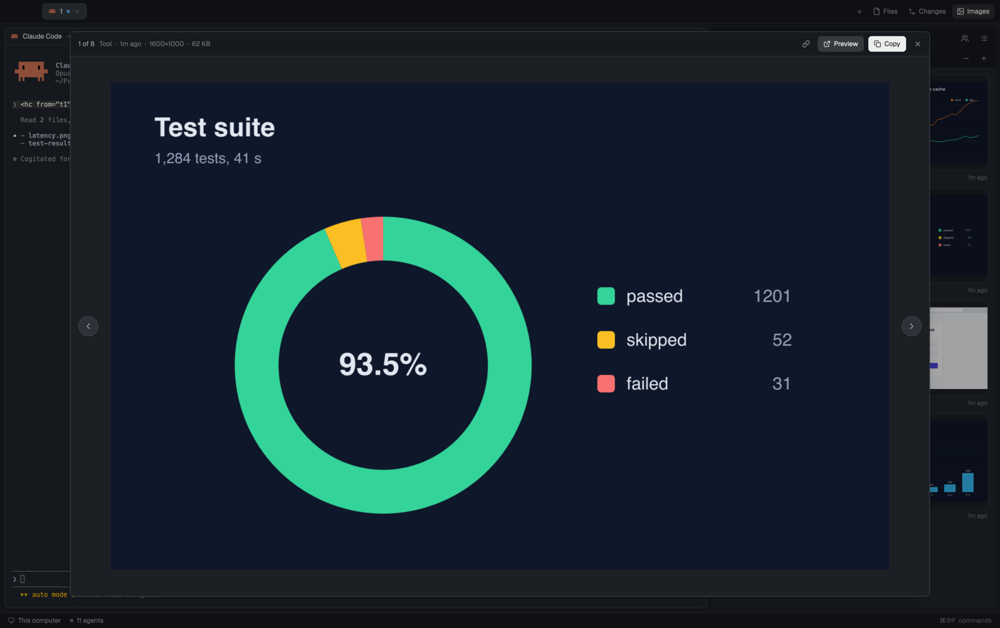

# Agent Gallery for herdr

A [herdr](https://herdr.dev) mod: a side panel with the images in your agents' conversations (pasted, read by tools, from subagents, or posted by the agent itself), local or on other machines. Grid or list, zoom, and a viewer with previous/next, copy, Preview and Open folder.

## Install

Ask your agent in herdr:

> Add the mod from https://github.com/martinek/herdr-agent-gallery

It follows `RECIPE.md`. To do it by hand, copy `mods/agent-gallery/` to `~/.config/herdr-app/mods/`. It docks as a column on the right.

`RECIPE.md` also has two optional steps:
- **An Images button** next to Files and Changes (a tab-bar clone and a layout edit).
- **Agents posting images:** `bin/herdr-post-image` plus the `skills/post-image` skill for Claude Code, on each machine that runs agents.

`demo/` holds the images in the screenshots and the script that draws them (`cd demo && python3 make.py` writes SVGs; `rsvg-convert -w 1600` turns them into PNGs).

## Requirements

- `python3` (3.9+) on every machine whose agents you want to see.
- macOS for Copy, Preview and Open folder; the panel itself works anywhere herdr does.
- Agents: Claude Code (with subagents), Codex, pi.

## License

MIT. Icons from [Lucide](https://lucide.dev) (ISC, `mods/agent-gallery/LICENSE-Lucide.txt`).
