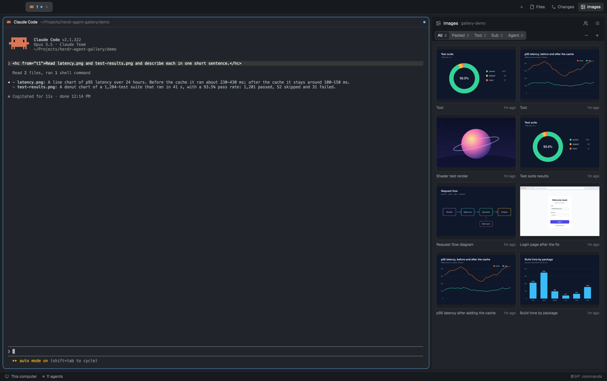

# Agent Gallery

A side panel with every image in the focused agent's conversation: screenshots you pasted, images its tools read, its subagents' images, and pictures the agent posted on purpose with `herdr-post-image`. It works for agents on other machines too. Thumbnails sit in a zoomable grid or a list; clicking one opens it large in a dialog where you can step through the rest, copy it or open it in Preview.



Before installing, know that the mod:
- runs programs: `python3` on the agent's machine (local or remote, through herdr's `exec`), `hc get`, and on macOS `sips`, `osascript` and `open`;
- reads files outside its folder: agent transcripts under `~/.claude/projects`, `~/.claude/sessions`, `~/.codex/sessions` and `~/.pi/agent/sessions`, and the outbox at `~/.cache/agent-gallery/outbox/` on each agent's machine;
- writes its cache to `data/agent-gallery/cache/` inside the app folder;
- never reaches the network.

## What you see

The panel is a column, 360px by default (`mod.json` docks it on the right), on the theme's `surface` color. From top to bottom:

1. **Title row**, 38px, `chrome` background, bottom border:
   - the `image` icon and "Images" (13px semibold);
   - the agent it follows, in `dim`: `space / tab · machine`, without a tab name that is only a number and without a machine for this computer. With all agents on, it shows "N agents" instead;
   - on the right, two 26px icon buttons: `users` (all agents, highlighted with `selected` when on) and the view toggle (`list` while in grid, `layout-grid` while in list).
2. **Filter row**, 34px:
   - a segmented control on `raised`: All, Pasted, Tool, Sub, Agent, each with its count in `dim` 11px. The selected one sits on `surface` with a small shadow;
   - in grid view, − and + on the right to zoom.
3. **Body**:
   - **Grid:** 12px padding, 10px gaps. Card widths step through 72, 100, 140, 190, 260 and 340px, stretched to fill the row. Each thumbnail box is 0.72 × the card width, rounded 6px, 1px border (`accent` on hover) on `canvas`. The image is scaled to fit inside it, up to 4× its own size, never cropped. Under cards at least 110px wide there's a caption line: the source (in `accent` for Pasted, `muted` otherwise), and on the right how long ago ("just now", "12m ago", "14:05", "Nov 9, 14:05"). In all-agents mode a second line names the agent. Narrower cards get the same text as a tooltip;
   - **List:** 54px rows, a 64×42 thumbnail, the same caption line, then dimensions and size ("1600×1000 · 412 KB");
   - newest first. The source label is "Pasted", "Tool", the subagent's description (or type), or for posted images the caption the agent gave (else "Agent").
4. **Footer**, only when images are listed and a refresh failed: 11px `dim` text, "Couldn't refresh: <reason>", or "N agents couldn't be read".

Empty states are centered: an `image` icon with "Couldn't start the Images panel" with the reason (the cache folder can't be made), "No agent in focus" (hint: "Click an agent's terminal; this panel follows it."), "Looking for images…", "Couldn't read this agent's images" with the reason, or "No images yet" / "No pasted images" etc. with "Paste one into the agent with ⌘V and it shows up here."

**Viewer:** a dialog at 86% × 90% of the window.
- A 44px top bar: "3 of 17", then source · agent · time · dimensions · size in `dim`, then four buttons:
  - copy file path (`link` icon);
  - "Preview" (`raised`);
  - "Copy" (`solid`), whose icon turns into a check in `working` for 1.2 s;
  - close (`x`).
- Below, on `canvas`, the image fitted to the space left after 72px on each side and 20px above and below, enlarged to at most 2×.
- With more than one image, 64px-wide side zones hold 36px round ‹ › buttons on `popover`.

## How it behaves

- It follows the focused terminal when that terminal runs an agent. With all agents on, it shows every agent's images together.
- It reads only while shown: on becoming visible, then every 4 s. A hidden panel does nothing.
- Each read runs `extract.py` on the agent's machine. That finds the transcript and returns only what was added since the byte offset it stopped at last time. Very little is sent when nothing changed.
- Hovering a card or row shows a copy button (macOS only). Clicking a card or row opens the viewer on it, with the filtered list it came from.
- In the viewer:
  - ← → (or the side buttons) step through the images and wrap around;
  - Space or ⌘O opens Preview;
  - ⌘C copies the image to the clipboard (non-PNG images are converted with `sips` first);
  - Esc closes the viewer.
  Preview, Copy and their keys appear only on macOS.
- Clicking the agent name under a card (all-agents mode) runs `agent.focus` for it.
- Filter, all agents, view and zoom are remembered (`localStorage`).
- Commands for `keys.json` or `herdr-app do`, reaching a shown panel: `agent-gallery.view` (the newest image of the current filter in the viewer), `agent-gallery.zoom-in`, `agent-gallery.zoom-out`, `agent-gallery.grid`, `agent-gallery.list`. No keys are bound by default.
- Cached pictures nobody has looked at for 7 days are deleted when the panel next starts. Posted images in the outbox are deleted after 7 days by the script on their machine.
- Agent statuses (working, blocked, done, idle) don't change the panel.

## Built from

- `mods/agent-gallery/`:
  - `main.js`, a single `View` that is both the panel and, when `props().viewer` is set, the viewer dialog (`openOverlay({ mod: "agent-gallery", kind: "dialog", width: 0.86, height: 0.9, props: { viewer: { index, items } } })`);
  - `extract.py`;
  - `mod.json` (`{ "place": "right", "size": 360 }`);
  - 13 Lucide icons (ISC, license included).
- herdr calls:
  - data: `focused()`, `agents()`, `layout()` (to tell whether the panel is shown), `theme()`, `window().platform`;
  - programs and files: `exec(…, { on: machine, timeout: 120000 })`, `hc(["get", t, "--json"])` (pid, argv, cwd and `created_ms` of the terminal), `readTextFile`, `appHome()`;
  - UI: `openOverlay` / `closeOverlay`, `notify`, `run("agent.focus")`, `nextCommand()` for the commands above;
  - plus `fs/promises` and `crypto`.
- **`extract.py`** (python 3.9+, standard library only). It gets the request as one JSON argument: `{pid, argv, cwd, known: {path: offset}, terminal, since, outbox_after, outbox_part}`. It runs as `sh -c 'python3 -c "$1" "$2"'`, so the remote login shell's PATH finds python. It finds the transcript by:
  - Claude Code: `~/.claude/sessions/<pid>.json` gives the session id, then `~/.claude/projects/*/<id>.jsonl`; subagents are `<id>/subagents/agent-*.jsonl` with `.meta.json` for agentType and description;
  - open `.jsonl` files of the process tree (`/proc` or `lsof`), for Codex and pi;
  - `--session <file>` in argv;
  - pi's newest session for the cwd.

  It yields base64 images from `{type:"image", source:{type:"base64"}}`, `{type:"image", data}` and `input_image` data URLs. A `user` role marks them as pasted, tool results as tool. It skips `api-request-blob` lines and lines still being written.
- **Cache:** `data/agent-gallery/cache/<sha256[:24]>.<ext>`, with the hash computed in the app, never taken from the remote. `index.json` holds per-transcript offsets, items and last-seen times.
- **Outbox protocol** (what `herdr-post-image` writes):
  - files go to `~/.cache/agent-gallery/outbox/$HC_TERMINAL_ID/<13-digit ms>-<name>.<png|jpg|gif|webp>` on the agent's machine, with an optional `<same name>.txt` caption. Names must sort after every earlier post;
  - the panel reads only posts newer than the terminal's `created_ms`, then resumes after the last name it read.

### Optional: an Images button next to Files and Changes

The shipped tab bar (`tabs`) has hard-coded buttons, so this needs a clone and a layout edit. Apply it to the person's own layout, not a shipped one:

1. `herdr-app do mod.clone '{"name":"tabs","as":"my-tabs"}'`, and in `mods/my-tabs/main.js`:
   ```js
   const listed = shared("workspace.panels") ?? ["files", "changes"];
   const enabled = find(root, "images") ? [...listed, "images"] : listed;
   ```
   in place of `const enabled = …`, and before the window buttons' `.when(w?.buttons, …)`:
   ```js
   .when(enabled.includes("images"), el => el.child(panelButton("images", "Images", "mods/agent-gallery/image.svg")))
   ```
2. In the layout (a clone of `main` if they use the shipped one):
   - point the tab bar's block at `"mod": "my-tabs"`;
   - add `{"id":"images","type":"block","content":{"mod":"agent-gallery"}}` to the `panel-body` stack's children;
   - remove the docked right-hand copy if Herdr already placed one.
3. The button toggles the panel and is remembered per space, like Files and Changes. The clone no longer receives Herdr's updates to `tabs`; redo it from the new `tabs` after an update.

### Optional: agents posting images

`bin/herdr-post-image` (POSIX sh, needs `perl` for milliseconds) and `skills/post-image/SKILL.md` sit next to this recipe. Copy them to `~/.local/bin/` and `~/.claude/skills/post-image/` on every machine that runs agents, then `chmod +x` the script. Agents then post with `herdr-post-image /abs/path.png "caption"`, and the image shows under **Agent** within a few seconds.

## Watch out

- `image()` loads only paths relative to the app folder (`~/.config/herdr-app`); absolute, `file://` and `../` paths draw nothing, without an error. That's why the cache sits in the app's `data/agent-gallery/cache/`, outside the mod folder so it doesn't trigger the mod's hot reload.
- `fs/promises` writes only where the real path is under the app folder. A mod folder that is a symlink (dotfiles) resolves elsewhere, so a cache inside it fails without an error. `data/` is always a real folder. If making the cache fails anyway, the panel shows the reason instead of "Looking for images…" forever.
- `image()` has no fit mode: it fills its box and crops. Size every image yourself from its width and height (read from the PNG IHDR or JPEG SOF header).
- An overlay's props arrive through `props()`, not `init`'s first argument. Reading the wrong one makes the dialog render the panel again, and every click stacks another dialog.
- `exec` with `on:` fails with an **empty** error somewhere between 5.6 and 6.8 MB of stdout, below the documented 8 MiB. `extract.py` stops at 2 MB of image data per call and says `more`; posts over 1.5 MB come in pieces (`part: {name, offset}`) that the app joins. A read that fails without advancing would resend the same payload every tick and make the window stutter.
- macOS `date` has no milliseconds; the post script uses perl, and bumps the timestamp past the last existing name so two posts in the same millisecond keep their order.
- Posted images are deduplicated by file, not by hash: the same picture posted twice with two captions is two cards. Transcript images are deduplicated by hash.
- One image in a transcript can't be split: an image bigger than the 2 MB budget still goes in one call. Claude Code keeps pasted images under about 5 MB, so this stays under the failure point.
- The tab name of a fresh tab is "1"; skip numeric tab names in the subtitle.
- Remote machines need `python3` on the login shell's PATH; Windows machines running agents are not supported by `extract.py`.

## Done when

- `herdr-app check ~/.config/herdr-app/mods/agent-gallery` passes.
- Focusing a Claude Code agent and pasting a screenshot into it shows that screenshot under **Pasted** within 4 s; an image it `Read`s shows under **Tool**.
- A subagent's image shows under **Sub**, labeled with the subagent's description.
- `herdr-post-image shot.png "Caption"` run inside an agent's terminal shows the image under **Agent** with "Caption"; a 3 MB PNG from a remote machine arrives byte-identical (compare sha256 of the cached file and the source).
- − / + change the thumbnail size, the list toggle switches views, the users button shows all agents with an agent name under each card, and clicking a name focuses that agent.
- Clicking a thumbnail opens one large, uncropped image; ← → and ‹ › step and wrap; Esc closes; on macOS ⌘C puts the image on the clipboard and Space opens Preview.
- With `mods/agent-gallery` a symlink to a folder outside the app folder, images still appear.
- `herdr-app do agent-gallery.zoom-out` shrinks the thumbnails and `herdr-app do agent-gallery.view` opens the viewer on the newest image.
- Closing the panel stops all reads (no `python3` processes on the agent's machine while hidden).
